<div align="center">

# SoulCaliburIII_Recomp

**A native Linux and Windows port of *Soulcalibur III* (NTSC-U, `SLUS-21216`), made by statically recompiling the game's PlayStation 2 code to C++.**<br>
Not an emulator: the game's own MIPS R5900 code, rebuilt as a native program on a reimplementation of the PS2 hardware.


<sub>Captured from the running port: native OpenGL renderer at twice the internal resolution
(<code>PS2X_GS_SCALE=2</code>, 1280x896).</sub>

</div>

> [!IMPORTANT]
> No game files are included: no ELF, IRX modules, AFS archives, or code generated from them.
> You need **your own copy** of the North American release, PS2 ID **`SLUS-21216`**. The port is built against that disc's executable:
>
> | File | SHA-1 |
> |---|---|
> | `SLUS_212.16` | `9bbb67a70137052931bc245855eedeee6bbe5b49` |

## Status

**Playable, at 60 frames per second.** A human played long sessions on 2026-11-01 ("it's playable"). The port runs
on PS2Recomp's native target: the GS stream drawn with OpenGL, the VU1 and VU0 microprograms as C++, the IOP modules
recompiled, the IOP and the SPU2 on the wall clock, the frame loop and the movies on real time. Fights run at about
60 frames per second on a Ryzen 7 7800X3D, with music and voices. Every mode has been played through with scripted input: Tales
of Souls to the credits, Chronicles of the Sword battles on the field map, World Competition, Soul Arena, Museum,
Character Creation, Shop and Options, with saves loaded back after a restart. The game runs its own `rand`: the
15-bit stub it used to be bound to made every random pick 0.

Known issues from that play session, being worked on: the analog sticks feel oversensitive (no deadzone yet), some
menu animations blink faster than on a PS2 (main menu, Single Player Modes; the main menu's water may be fast too,
to be measured against PCSX2 at the same frame rate), and a purple overlay shows on some frames at the end of a
loading screen or a screen change.

**Now: removing the last of the emulation.** The goal, set by the project's owner for every PS2Recomp port, is no
emulated PS2 hardware at all, not even a small part, and never kept because it is faster: no GS front end or GS
memory, no GIF or VIF packet read, no VU or SPU2 model, frames on the PC's clock. Twisted Metal: Black's port reached
it first and SC3 follows its route (see the layers below and the [function map](#function-map)).

| Milestone | |
|---|:---:|
| Map and recompile the main ELF (12,900 functions) | ✅ |
| Boot: EE kernel, the game's own IOP modules, CD reads from the disc files | ✅ |
| Logos and movies (CRI Sofdec, decoded on the host) | ✅ |
| Title screen, menus, character and stage select | ✅ |
| Music and voices (CRI ADX on the game's own `CRI_ADXI.IRX`, SPU2) | ✅ |
| Fights at 58-60 fps (VU1 on its own thread) | ✅ |
| Tales of Souls, World Competition, Soul Arena, Museum, Shop | ✅ |
| Chronicles of the Sword: story, field map, battles | ✅ |
| Memory card: save and load | ✅ |
| Random picks (the game's own `rand`) | ✅ |
| Long play sessions by a human | ✅ |
| Native GS renderer (OpenGL), recompiled IOP modules, IOP and SPU2 on the wall clock | ✅ |
| Higher internal resolution (`PS2X_GS_SCALE`) | ✅ |
| Frame loop on the native FramePacer | ✅ |
| VU1 microprograms on the native sandbox, no emulated VU1 | ✅ |
| VU1 and VU0 microprograms in C++, no VU emulation left | ✅ |
| VU1 programs drawn from their computation: no GIF packets, no GS register replay | ✅ |
| Analog deadzone, menu animation speed, transition overlay (play-session reports) | 🔧 |
| Sound mixed natively at libsd's API, no SPU2 emulation | 🔧 |
| Textures and meshes from offline packs of your disc, 2D drawn in C++ | 🔧 |
| No GS front end, GS DMA and VIF left unread | ⏳ |
| Windows build (MSYS2 UCRT64 or llvm-mingw): boots, movies, menus and fights in a Windows 11 VM; sound and a real GPU still to check | 🔧 |
| Widescreen | ⏳ |

✅ works · 🔧 in progress · ⏳ not reached yet

**Native port** (no PS2 hardware emulation left, not even a small part: the shared goal of PS2Recomp's ports, and
never kept because it is faster). Native means the game's draws built straight from its own data, its sound mixed
at its sound library's API, and its frames on the PC's clock, with no PS2 hardware model in between. SC3 pins
PS2Recomp's `sc3/windows` branch (`sc3/native-vu1`, i.e. `native/renderer` plus SC3's fixes, with the Windows fixes); the details of each layer are in
[RECOMP_NOTES.md](RECOMP_NOTES.md#native-target-as-of-2026-11-01).

| Layer | |
|---|:---:|
| IOP modules (CRI_ADXI, LIBSD, SDRDRV, NUSOUND, MCMAN, MCSERV, PADMAN, SIO2MAN) recompiled to C++, none interpreted (`scripts/iop_recomp.sh`) | ✅ |
| Sound and IOP on the PC's clock (`PS2X_SPU2_WALLCLOCK=1`, `PS2X_IOP_WALLCLOCK=1`) | ✅ |
| No paraLLEl-GS: OpenGL on the GPU (the GS native back end), higher internal resolution (`PS2X_GS_SCALE`) | ✅ |
| Frame loop and one-shot movies on the PC's clock (`FramePacer`; `SC3_NATIVE_FRAMES=0`: the vblanks) | ✅ |
| Every VU1 and VU0 microprogram translated to C++ (`tools/vu1_lift.py`), no VU interpreter and no sandbox | ✅ |
| VU1 programs draw from their computation: no GIF packet, no GS register replay (`runtime/sc3_draw_sink.cpp`) | ✅ |
| No SPU2 emulation: libsd's calls played by PS2Recomp's native mixer, the SPU2 absent | 🔧 |
| Textures from an offline native pack of your disc, looked up by the game's own keys | 🔧 |
| Materials and 3D meshes from offline packs, drawn at the game's per-object hooks; no VIF stream read | ⏳ |
| 2D (menus, fonts, the fight HUD) built in C++ from the game's variables by default, from an offline 2D pack of your disc (`SC3_NATIVE_2D=0`: the game's own packets); left to the game: the passes that read the frame (glow, display copy) and the frame's context writes | 🔧 |
| Shadow volumes, glow and the sun's depth probe as native passes | ⏳ |
| Movies as native pictures: full-screen ones the native renderer's backdrop, no libmpeg or IPU; menu previews drawn by the native 2D from the host decoder's picture | 🔧 |
| The frame's end written to the game natively (SC3 waits on the GS's FINISH), GS DMA and VIF0 left unread | ⏳ |
| No GS front end, no copy of GS memory: the native renderer draws and presents the whole frame | ⏳ |
| IOP kernel layer (interrupts, timers, SIF) under the recompiled IOP modules: still PS2Recomp's model | ⏳ |

✅ works · 🔧 in progress · ⏳ not reached yet

The order of the remaining work, each step leaving the game playable and checked
picture by picture against the current path: textures, then materials, from offline packs converted from your own
disc (the game stores both only as ready-made GS and VIF data; the packs stay in the build tree, never in the
repository); meshes from a pack at the game's per-object hooks, with the vertex programs as plain C++; the 2D
builders rewritten in C++ from their MIPS; shadow volumes as a stencil pass, the glow chain as a native post effect,
the sun's depth probe read from the native depth buffer; movies as native pictures; then the frame's end written to
the game natively (SC3 waits on the GS's FINISH every frame, unlike TMB), so the GS DMA and VIF0 can be left unread;
then no GS front end at all.

### Function map

<p align="center"></p>

<sub>2026-11-01: 1,056 of 12,910 EE functions still touch emulation (122 directly, 934 through calls), 91.5%
emulation-free by this count. The count misses most of the remaining work: the builders that only fill packet
buffers look clean, since what reads those buffers is the emulated DMA and GS. It drops as the milestones above turn
them into native code.</sub>


`scripts/func_map.py` draws every EE function of the ELF as one square, in address order, coloured by how far it
is from running without emulation: native C++ (game overrides, VU program ports), recompiled and clean, touching
emulated hardware itself (DMA, VIF, GIF, GS privileged registers, VU memory and control, timers, INTC), calling such a
function one or two levels down, or answered by a runtime stub (native or emulation-backed). The eight recompiled IRX
modules get a smaller map of their own. It is static analysis of the MIPS plus the overrides and PS2Recomp's stub
sources; the page lists its rules and blind spots.

```sh
python3 scripts/func_map.py --out build/funcmap          # after scripts/recomp.sh; PS2Recomp submodule checked out
python3 scripts/func_map.py --elf <SLUS_212.16> --generated <generated/> --ps2recomp <PS2Recomp/> --out <dir>
```

Python 3 with the standard library only, on Linux and Windows. It writes `map.html` (interactive, one
self-contained page), `map.svg`, `map.json` and appends the counts to `history.json` in `--out` (`--history` puts
the trend elsewhere), so each run adds a point to the "functions still touching emulation" line. `--coverage <file>`
overlays a list of function addresses that ran. The outputs name game addresses: keep them out of the repository.

[RECOMP_NOTES.md](RECOMP_NOTES.md) records how the port was brought up, every fix and how it was found.

## Goal

A fully playable *Soulcalibur III* as a native executable, every mode from the opening movie to the endings, at the
original 60 frames per second. Accuracy first; once it is solid, widescreen and higher internal resolution.

## How it works

```
disc files ──► Ghidra (headless, EE) + ps2_analyzer + recomp/*_hints.txt ──► recomp/sc3.toml
                                           │
                                ps2_recomp ──► C++ (one file per function)
                                           │
             VU1/VU0 microcode in the ELF ──► ps2_vu_aot ──► C++ (generated/vu1/) ──► vu1_lift.py ──► C++ (generated/vu1port/)
                                           │
   PS2Recomp runtime: EE kernel HLE · DMAC · GIF/GS · VIF/VU0/VU1 ─┼─► ps2EntryRunner
   PS2Recomp IOP:     the game's own IRX, recompiled (generated/iop/) or interpreted · SPU2 · SIO2
```

- The ELF has no symbols. Ghidra maps the functions; `scripts/find_code_pointers.py` adds those reached only through
  pointers, jump tables or tail calls (the hint lists in `recomp/`).
- PS2Recomp turns every function into C++. `ps2_vu_aot` finds the VU1 and VU0 microprograms in the ELF and compiles
  them ahead of time; PS2Recomp's `tools/vu1_lift.py` (the programs listed in `recomp/vu1_lift_spec.json`) turns the
  two VU1 programs and the VU0 program into C++ without a
  pipeline to run: VU1's runs on the VIF1 thread and draws through the GS back end, VU0's on the EE's VCALLMS.
- The GS stream is translated into OpenGL draws by PS2Recomp's native GS back end, the CPU rasterizer stays as the
  validation reference.
- `runtime/sc3_overrides.cpp` holds the game-specific bindings: reserved memory, a host Sofdec movie player and
  mixer, the renderer and timing choices, and diagnostic tracers.

The runtime is the `PS2Recomp/` git submodule: [TheBozos/PS2Recomp](https://github.com/TheBozos/PS2Recomp), branch
`sc3/windows` (`native/renderer` plus SC3's fixes, the VU program hooks and the Windows build fix), the fork shared with the *Twisted Metal: Black*, *Valkyrie Profile 2: Silmeria*, *The Lord of the Rings: The
Third Age* and *Drakengard* recompilations; the port builds on the same runtime as the others.
The top-level `CMakeLists.txt` builds its runtime, swaps its placeholder function table for the generated one and
links the generated code, `runtime/` and the compiled VU1 microcode into `ps2EntryRunner`. Every fix made for this
port is generic and shared, for example the IOP interrupt suspension that kept CRI ADX streams alive, the VU0
VCLIP flags and VU1 run-ahead on its own clock.

## Requirements

- Linux (developed on Arch) or Windows 10/11 with [MSYS2](https://www.msys2.org/) (UCRT64, see [Windows](#windows))
- CMake 3.21+, Ninja, Clang with C++20 (or MSYS2's GCC on Windows), rsync, and bsdtar (libarchive) to extract the disc
- FFmpeg development libraries (`libavcodec`, `libavformat`, `libavutil`, `libswresample`, `libswscale`)
- X11/Wayland and OpenGL development headers (raylib is fetched and built by the runtime)
- An OpenGL 4.5 driver (any recent NVIDIA, AMD or Intel driver)
- Ghidra with the Emotion Engine extension, only to regenerate the function map
- Your own copy of `SLUS-21216` as a disc image (the extracted ELF is checked against the hash above)

## Build and run

```bash
git clone --recurse-submodules https://github.com/TheBozos/SoulCaliburIII_Recomp.git
cd SoulCaliburIII_Recomp
scripts/extract_iso.sh "/path/to/Soulcalibur III (USA).iso"   # disc files -> game/
scripts/build_tools.sh                                         # ps2_recomp, ps2_analyzer, ps2_vu_aot -> build/tools
scripts/recomp.sh                                              # SLUS_212.16 + recomp/sc3.toml -> generated/, VU microcode -> generated/vu1/, VU programs in C++ -> generated/vu1port/
scripts/build_runtime.sh                                       # runtime + generated code -> build/game (RelWithDebInfo)
scripts/iop_recomp.sh && scripts/build_runtime.sh             # the IRX modules as native code -> generated/iop/
scripts/run.sh                                                 # ps2EntryRunner game/SLUS_212.16
```

The extracted disc folder is the game's `cdrom0:`; the memory cards and settings live in a per-user folder (see
[Saves, settings and logs](#saves-settings-and-logs)). Started with no argument, the runner boots `game/SLUS_212.16`
next to it, then the same under the user folder.

`JOBS=<n>` sets the build parallelism of every script (default: all cores). The generated code is about 12,900 C++
files; a clean build of the tools and the game (recompile included) takes about 13 minutes with `JOBS=8` on a Ryzen 7
7800X3D, most of it the runner. `scripts/build_runtime.sh Release` or `Debug` picks another build type, and `CXX`
another compiler (Clang is used when it is installed).

`scripts/remote_build.sh` builds the runner on another x86-64 Linux machine over ssh (`REMOTE_HOST`, default
`stallman`) and copies it back to `build/game`; the game still runs locally. It sends `CMakeLists.txt`, `runtime/`,
`generated/` and `PS2Recomp/` with rsync and builds them with Clang 23 from mise (conda-forge) on the remote host's
GCC headers, libstdc++ and linker, so the runner needs nothing newer than what the local machine has. The remote host
needs rsync, mise and the X11 and OpenGL development headers, but not FFmpeg: the local FFmpeg headers and libraries
are copied over once, so the runner links against the FFmpeg it runs with. On a 40-core Debian 12 host a clean runner
build takes about 4 minutes of compiling and 6 minutes overall, and a rebuild with nothing changed about 15 seconds.

`scripts/regress.sh build/game ~/sc3-regress` checks a build for regressions: it boots with movies off, goes through the
menus into a Free Training fight, attacks for a minute, then writes a verdict to `summary.txt` (route reached, ok,
hang or crash, GS frame rate, SPU2 underruns) with the last frame and the log.

### Saves, settings and logs

| | Linux | Windows |
|---|---|---|
| User folder | `$XDG_DATA_HOME/soulcalibur3_recomp` (`~/.local/share/soulcalibur3_recomp`) | `%APPDATA%\SoulCaliburIII_Recomp` |

It holds the memory cards (`mc0/`, `mc1/`), the controls (`input.ini`), the video settings (`video.ini`), the debugger's
window layout (`imgui.ini`) and the log of the last three runs (`logs/SoulCaliburIII_Recomp.log`, `.1.log`,
`.2.log`); on Windows also `crashes/crash-<time>.txt`, a report shown in a message box when the runner crashes.
`PS2X_USER_DIR=<dir>` uses another folder, `PS2X_LOG_FILE=<file>` writes the log there (`0`: no log file), and
`PS2X_NO_DIALOGS=1` keeps the message boxes in the log only, for unattended runs.

Cards and settings kept next to the ELF by an older build (`game/mc0`, `game/mc1`, `game/input.ini`,
`game/video.ini`) are copied into the user folder on the first launch from that game folder, which is then listed in
`migrated.txt`; a save the user folder already has is not overwritten, and nothing next to the ELF is changed or
deleted. `scripts/regress.sh` and `scripts/sc3run.sh` run on a user folder of their own, with blank cards, and never
touch the player's saves.

### Windows

The same scripts run in an MSYS2 **UCRT64** shell, with MSYS2's GCC (MSVC is not supported):

```bash
pacman -S --needed mingw-w64-ucrt-x86_64-{gcc,cmake,ninja,pkgconf,ffmpeg,libarchive,python} git rsync
git clone --recurse-submodules https://github.com/TheBozos/SoulCaliburIII_Recomp.git
```

Then follow the steps above. `scripts/build_runtime.sh` ends with `scripts/stage_dlls.sh`, which copies the DLLs the
runner needs (compiler runtime, FFmpeg and their dependencies) from the MSYS2 prefix next to `ps2EntryRunner.exe`,
so it also starts outside the MSYS2 shell. With `mingw-w64-ucrt-x86_64-clang` installed it builds with Clang, as on
Linux; the **CLANG64** environment works the same way with the `mingw-w64-clang-x86_64-` packages. The runner runs
the same native defaults as on Linux and needs an OpenGL 4.5 driver. Profile with `PS2X_PROFILE=<s>` (no `perf`);
`scripts/remote_build.sh`, `scripts/threadcpu.sh` and the screenshot of `scripts/sc3run.sh` are Linux only.

A controller is used when one is connected; otherwise the keyboard (US key positions). A second gamepad plays
player 2:

| PS2 button | Keyboard |
|---|---|
| D-pad | Arrow keys or W A S D |
| Cross / Circle / Square / Triangle | X or Space / C or Esc / Z or Numpad 0 / V or Numpad 1 |
| L1 / R1 / L2 / R2 | Q / E / Left Shift / Right Shift |
| Start / Select | Enter / Tab |

| Key | What it does |
|---|---|
| F1 | Runtime debugger |
| F3 | Frame rate and emulated EE speed overlay (`PS2X_SHOW_FPS=1` starts with it on) |

<details>
<summary><b>Runtime and diagnostic options</b></summary>

| Variable | Effect |
|---|---|
| `PS2X_GS_RENDERER=cpu` | Draw with the CPU rasterizer, the reference, instead of the native GS back end |
| `PS2X_GS_SCALE=<n>` | Internal resolution multiplier of the native GS back end |
| `PS2X_IOP_NATIVE=0` | Interpret the IRX modules instead of running their recompiled code |
| `PS2X_IOP_WALLCLOCK=0` | Run the IOP on the EE cycles the game accounts instead of the host's clock |
| `SC3_NATIVE_MOVIES=0` | Show full-screen movies by replacing the presented frame (the presentation override) instead of as the native renderer's backdrop, and set up Sofdec's decoders through the MPEG HLE |
| `SC3_NATIVE_VU1=0` | Run the VU1 microprograms on the emulated VU1 instead of in C++ |
| `SC3_NATIVE_VU1_PORT=0\|check` | Run the VU1 programs on the native sandbox (the AOT microcode on PS2Recomp's interpreter) instead of in C++, or both, compared |
| `SC3_NATIVE_VU1_PORT_SKIP=<A:0x10,…>` | Keep those entries on the sandbox |
| `SC3_NATIVE_VU1_DIRECT=0\|check\|@file` | Draw the C++ programs from their GIF packets (parsed, their register writes replayed on the GS) instead of directly, or both, compared; `@file` reads 0 / 1 / check at each frame end |
| `SC3_NATIVE_MESHES=1\|check` | The stage's rigid parts drawn natively from the offline mesh pack (`build/sc3_meshes.pack`, made by `scripts/sc3_mesh_pack.py` from your disc) at the game's part builder; needs the texture pack on (`SC3_TEXTURE_PACK_MODE=keep`); `check` compares each part with the lifted VU1 program. Opt-in, in progress: see RECOMP_NOTES |
| `SC3_NATIVE_2D=0\|check\|@file` | The 2D builders (menus, text, labels, icons, draw items, the fight HUD) are C++ by default, textured from the offline 2D pack (`build/sc3_2d.pack`, made by `scripts/sc3_2d_pack.py` from your disc); `0` gives them back to the game's own packets, `check` builds both and compares them word for word, `@file` reads 0 / 1 / check at each frame end |
| `SC3_TEXTURE_PACK_MODE=1\|keep\|@file` | Direct draws textured from the offline texture pack (`build/sc3_textures.pack`, made by `scripts/sc3_texture_pack.py` from your disc), the uploads it covers left out (`keep`: still sent); a diagnostic for now, see RECOMP_NOTES |
| `SC3_HIDE_EE=<addr,…>`, `SC3_TRACE_LOAD=1`, `SC3_TRACE_FRAMES=<frame>,<n>`, `SC3_TRACE_OT=1`, `SC3_RECORD_FRAME=<frame>` | Census: game functions returned at entry, file loads, one frame's batches / texture uploads / sync points / direct draws, ordering-table insertions, one frame's builder calls with their state and memory dumps (`SC3_RECORD_DIR`) |
| `SC3_NATIVE_VU0=0\|check` | Run the VU0 microprograms on PS2Recomp's interpreter instead of in C++, or both, compared (`SC3_NATIVE_VU0_LOG`, `SC3_NATIVE_VU0_RECORD` as for VU1) |
| `SC3_NATIVE_VU1_LOG=1` | Every 5 s, MSCALs by entry, the direct draws' counts; a line lists any without a C++ port |
| `SC3_NATIVE_VU1_RECORD=<file>` | Record sampled sandbox runs per entry (and, with `=check`, runs whose port differs) for `sc3_tests` (`SC3_VU1_TRACE`) |
| `PS2X_VIF1_THREAD=0` | Run VIF1 and the VU1 microcode on the game thread (default: their own thread, about a third faster in fights) |
| `PS2X_EE_CATCHUP=0\|field\|1` | Wall-clock catch-up: SC3 defaults to off, so emulated time never runs faster than real time |
| `PS2X_SC3_NO_MOVIES=1` | Skip the one-shot movies (for tests) |
| `PS2X_SC3_AUTOWIN=1` | Keep the player at full health and the opponent at 1 HP, so scripted input wins each fight |
| `PS2X_PAD_SCRIPT=t:BUTTON[/ms],…` | Scripted button presses (seconds from start); `PS2X_PAD_INPUT=<file>` reads presses appended to a file while the game runs |
| `PS2X_PAD2_SCRIPT=t:BUTTON[/ms],…` | Player 2's scripted presses in the same format; plugs in the second controller without a second gamepad |
| `PS2X_STATE_DUMP=<s>` | Every few seconds: EE and IOP threads, GS frames, EE speed, DMA and VIF counters, SPU2 state |
| `PS2X_FRAME_DUMP=<dir>`, `PS2X_FRAME_DUMP_EVERY=<s>` | Save the presented frame as raw 640x448 RGBA |
| `PS2X_PROFILE=<s>` | Sampling profiler: where every host thread spends its time |
| `PS2X_EE_PROFILE=1` | EE cycles by guest loop, in the state dump |
| `PS2X_GS_DUMP_WHEN=<file>` | Log the next GS primitives once that file appears (`PS2X_GS_DUMP_OUT`, `PS2X_GS_DUMP_COUNT`) |
| `PS2X_SC3_TRACE_ADXT=1`, `_TASKS`, `_ENTRY=<addr,…>`, `_OBJ`, `_FADE`, `_MOVIE` | Game tracers: ADX player states, task creation, guest function entries, object fields, fades, movies |

</details>

## On BozoEngine

The port is moving to [BozoEngine](https://github.com/TheBozos/BozoEngine) (the `BozoEngine` submodule, at a merged engine
commit), next to the PS2Recomp build until the switch. Headless, it boots to the title and runs the reference route's
11700 frames with no fault. Movies play with sound (FFmpeg from the disc image, pictures on the renderer's backdrop, the soundtrack in the mixer), and frames are held to 60 a second in a window. `[sc3:acknowledged]` at a run's end counts the guest's hits on registers that have no device behind them. It reads 0 on the route and on the boot with movies: the renderer's packet API (bozo/port/sc3_packet.cpp) copies as plain memory work, the remaining sites are patched (recomp/sc3_patches.txt) or answered at their functions.

```bash
git submodule update --init BozoEngine
scripts/bozo_build.sh                 # build/bozo: sc3, sc3-headless, sc3-check (SC3_ELF, SC3_ISO)
scripts/bozo_headless.sh first --frames 300
```

`-DBOZO_ENGINE_DIR=<tree>` (`bozo_build.sh --engine`) builds against another engine tree. `-DSC3_EXTERNALS=<file>`
generates with `bozo-calllog-tool externals`' list, which `sc3-check --pinned` needs. The program sources are in `bozo/`, the
recompiler's inputs in `recomp/` (`sc3_stubs.txt`, `sc3_entries.txt`, `sc3_symbols.txt`), and what it is compared with in
[`reference/`](reference/README.md).

The packs (`cmake --build <build> --target sc3_packs`) are built from the disc's files into `<build>/packs/`. The programs
read them from the `SC3_2D_PACK`, `SC3_TEXTURE_PACK` and `SC3_MESH_PACK` variables, else from `packs/` beside the
executable, and the symbol map from `SC3_SYMBOL_MAP`, else `sc3_symbols.txt` beside it.

Windows from Linux: a mingw-w64 GCC that targets the UCRT (the compiler of MSYS2 UCRT64 and TMB's kit) builds it with
`cmake/mingw-cross.cmake`. `SC3_HOST_TOOLS` names a native build's `bozo-externals` and `bozo-recomp`, and
`scripts/build_win_ffmpeg.sh` builds the static FFmpeg it links. `sc3-check.exe` needs `-DBOZO_BUILD_TOOLS=ON` and a
static zlib built with the same compiler (`-DZLIB_ROOT=<prefix>`). Clang targets (zig c++, llvm-mingw) build a binary that
crashes, so they are not supported: on Win64 their `__builtin_longjmp` restores rbp from the frame address instead of the
frame pointer, which breaks BozoEngine's stops. `scripts/make_win_package.sh` lays out a portable folder from that build:
the programs, the symbol map and `packs/`. That folder holds code and packs made from the disc, so it never leaves the
machine that built it.

### A player's build: sc3_build.py, the build kit and the launcher

A player builds the game on their own PC from their own disc; nothing made from the disc is ever distributed. This is
TMB_Recomp's pattern:

- `scripts/sc3_build.py --disc <image or extracted folder> --out <work folder>` checks the disc (SLUS_212.16's SHA-1),
  extracts what the build reads (the ELF, `ROOT.OLK`, the three sound modules), configures, builds the recompiler,
  generates the code, makes the packs, compiles `sc3` and stages a game folder: `sc3.exe`, `SLUS_212.16`,
  `sc3_symbols.txt`, `packs/`, `disc.iso` (a hard link to the image when it can) and `Play SC3.cmd` (`play_sc3.sh` on
  Linux). Each step is skipped when its inputs did not change; `--check` checks a disc only. Without a kit it uses
  the PATH's GCC, CMake and Ninja (or `--toolchain C:/msys64/ucrt64`) and FFmpeg through pkg-config.
- `scripts/make_build_kit.py` (on Windows, with MSYS2 and the network) assembles the kit a player needs with nothing
  installed: MSYS2 UCRT64's GCC, CMake and Ninja at the versions `scripts/build_kit_packages.json` pins, a static LGPL
  FFmpeg with only what the movies need, SDL3 and Dear ImGui sources, and an embeddable Python.
- `launcher/` is SC3 Launcher.exe: pick the disc image, Prepare (sc3_build.py on the kit's Python), Play, Update.
- `scripts/make_release.py` makes the player's zip from a commit: the source (and BozoEngine's), the kit, the launcher,
  the licences and the corresponding sources; `.github/workflows/release.yml` runs it on a version tag and makes a
  draft release. A release needs a `LICENSE` at the repository's top and a `CHANGELOG.md` section for its version.

## Disc facts

| | |
|---|---|
| Boot ELF | `SLUS_212.16`, entry `0x100008`, stripped |
| Video mode | NTSC (`SYSTEM.CNF` `VER = 1.01`) |
| IOP modules | `IRX/*.IRX`: CRI_ADXI, LIBSD, MCMAN, MCSERV, NUSOUND, PADMAN, SDRDRV, SIO2MAN |
| IOP image | `IOPRP300.IMG` |
| Data | `ROOT.OLK`, `BGM.AFS`, `SE.AFS`, `VOICE.AFS`, `MOVIE.AFS` (Sofdec) |

## Repository layout

| Path | Contents |
|---|---|
| `PS2Recomp/` | The recompiler and runtime (git submodule, TheBozos/PS2Recomp branch `sc3/windows`) |
| `BozoEngine/`, `cmake/bozo.cmake`, `bozo/` | The port on BozoEngine: the engine (git submodule), its build (`SC3_BOZO=ON`), the three programs and port code |
| `reference/` | Hashes and scripts of the reference runs of the PS2Recomp build |
| `CMakeLists.txt` | Builds the runtime with the generated code and the game overrides linked in |
| `recomp/` | Recompiler config (`sc3.toml`), the VU programs to lift (`vu1_lift_spec.json`), the Ghidra function map and the entry-point hint lists |
| `runtime/` | Game override module (`sc3_overrides.cpp`), the native VU1 hooks (`sc3_native.cpp`), the VU1 program ports' entry table (`sc3_vu1_programs.cpp`), the VU0 hook (`sc3_vu0.cpp`), B:0x1388 by hand (`sc3_vu1_port.cpp`) |
| `scripts/` | Build, recompile and run scripts; disassembly, IRX and profiling helpers |
| `patches/` | Experiments kept for reference |
| `docs/screenshots/` | Pictures of the running port |
| `tests/` | `sc3_tests` (`SC3_BUILD_TESTS=ON`): the VU1 and VU0 ports against the interpreter and recorded runs |
| `RECOMP_NOTES.md` | How the port was brought up, the fixes and the debugging tools |
| `game/`, `generated/`, `build/` | Created by the scripts, ignored by git: disc files, generated C++, builds |

Everything derived from the game (disc files, generated code, builds, logs) stays outside this repository.
Never commit or redistribute it.

## Credits

- [PS2Recomp](https://github.com/ran-j/PS2Recomp) by ran-j and contributors (GPL), the recompiler and runtime this port is built on.
- [TheBozos/PS2Recomp](https://github.com/TheBozos/PS2Recomp) and the *Twisted Metal: Black*, *Valkyrie Profile 2: Silmeria*, *The Lord of the Rings: The Third Age* and *Drakengard* recompilations developed on it; runtime fixes are shared both ways.
- *Soulcalibur III* © Bandai Namco Entertainment, developed by Project Soul. This is an unofficial fan project, not affiliated with or endorsed by them.
